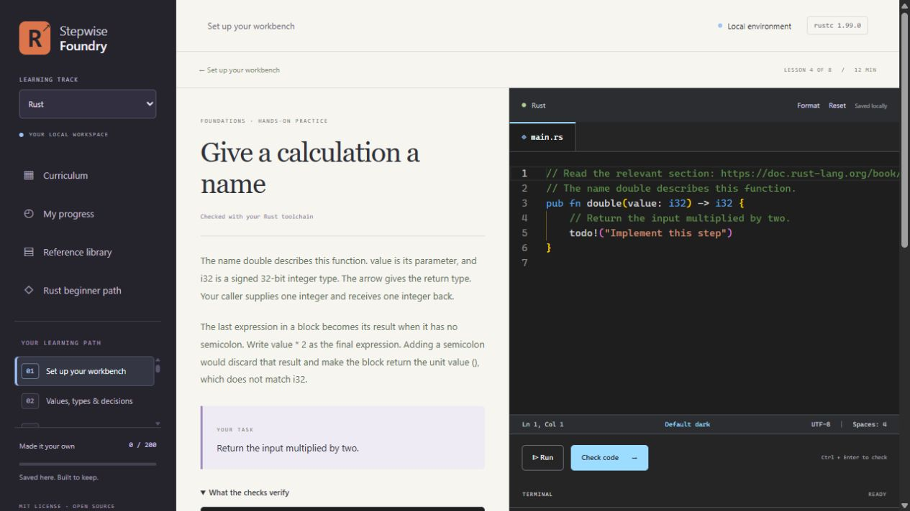

# Stepwise Foundry

Learn programming locally: read a short explanation, follow the official reference, write code, and check what it actually does.

Stepwise Foundry is a free, MIT-licensed learning workbench with a Monaco code editor, real local execution, and progress stored on your computer. It started as a learner's project built with Codex. The teaching material is AI-assisted and needs continued human review; passing checks or mentor review does not establish mastery.

See the [changelog](CHANGELOG.md) for updates.



| Track | Lessons | Runtime |
| --- | ---: | --- |
| Rust | 200 | Rust through rustup; edition 2024 |
| Python | 100 | Python 3.15 |
| PyTorch | 60 | PyTorch 2.14 CPU, Python 3.14 |
| Hugging Face | 48 | Python 3.14 with the pinned ML packages |

There are no accounts, rankings, streaks, telemetry, payments, or required model API keys. Built-in ML exercises use tiny local data and randomly initialized models without downloading pretrained weights. Online documentation and first-time dependency installation require internet access.

## Quick start

Install [Node.js 22 or newer](https://nodejs.org/), then the runtime for the subject you want to study. For Rust, install [Rust through rustup](https://rust-lang.org/tools/install/) and confirm `rustc --version` and `cargo --version` work in your terminal. On Windows, Rust's MSVC toolchain also needs the Visual Studio C++ build tools. For Python, PyTorch, or Hugging Face, follow the Python and ML setup below; studying those tracks does not require Rust.

```sh
git clone https://gitlab.com/koraji95coder/stepwise-foundry.git
cd stepwise-foundry
npm ci
npm start
```

Open [127.0.0.1:4173](http://127.0.0.1:4173). Stop with Ctrl+C and use `npm start` to return. Rust works without installing the optional Python environments. Code uses a portable dark theme and system monospace fonts; no personal editor profile is needed.

The full app was tested on Windows, and the core tests also pass in Linux CI. macOS installation feedback is welcome. The optional guided Rust beginner path currently teaches PowerShell commands. The main 408-lesson curriculum is separate and freely navigable.

## Choose your track and learn by doing

Choose from **Rust, Python, PyTorch, and Hugging Face**. All four tracks use the same practice loop: read a short explanation and the linked official documentation, predict the result, edit the commented starter, run or check it, and explain what you observed. Hints, worked solutions, notes, and exportable progress support that process. Checks execute real assertions or expected compiler diagnostics; manual field labs are explicitly self-reported.

You can bring any track's exported mentor report to a person or an assistant for feedback. The app also includes an optional, section-by-section review gate workflow. Its first authored sequence is a Rust beginner project: eight chapters and thirty sections covering folders, Cargo, a first program, values, variables, functions, and function inputs. Small prediction/planning sections precede project edits. A mentor reviews the exact response before the next section opens. It uses a new practice folder you choose; the app does not create or edit that external project.

Mentor review is a local workflow, with messaging disabled by default. Bring the exported handoff to a human mentor or an assistant with local project access. An optional [Codex Desktop bridge](docs/CODEX-DESKTOP.md) queues a request in an existing chat only when you explicitly submit. It needs no model API key or periodic AI checks; actual reviews use your normal Codex allowance. Automatic local feedback updates show a recorded review and open the next section without losing the preceding feedback. See [the beginner and mentor guide](docs/BEGINNER.md). General curriculum exercises remain available while a guided section awaits review.

Local checks assess executable code. Written predictions and explanations are saved for comparison or mentor review; they are not automatically graded for understanding.

## Try a concept again later

**My progress → Revisit a concept** opens an optional [delayed-practice pilot](docs/REVISITS.md): one changed Rust function task after a day and one Python task after two days. Each becomes available after its original lesson is completed. Save a prediction and code attempt before checking, then compare the result. Hints and the worked example become available after the first completed attempt; assistance is recorded per attempt. These revisits keep their own history and do not alter course completion, block lessons, or claim mastery. There are no scheduled agent wakeups.

## Optional Python and ML tracks

Use an existing Python installation to run:

```sh
python scripts/setup-python.py --python-only
# To also install the CPU ML environment:
python scripts/setup-python.py
```

On Windows, setup downloads the official Python 3.15 runtime and verifies its advertised SHA-256. It creates `.venv-python` for the language track and `.venv-ml` for ML. The ML environment needs a Python 3.14 bootstrap interpreter (`py -3.14` on Windows or `python3.14` elsewhere). These installs can be large and require network access. No system Python or PATH changes are made.

On macOS/Linux, install Python 3.15 yourself or set `PYTHON315` to its executable. `PYTHON_ML_BOOTSTRAP` can select a Python 3.14 interpreter. Setup writes machine-local paths to ignored `.runtime/runtimes.json`. `WORKSHOP_PYTHON` and `WORKSHOP_ML_PYTHON` override those paths. Restart the server after setup. Other Python/ML versions are not verified against this curriculum's pinned checks.

## Keep your learning record

Drafts, notes, attempts, review receipts, and completion records live in `.data/progress.json`, with atomic saves and a previous-file recovery copy. Each new guided submission retains a snapshot of its answer/output and the mentor feedback attached to that submission ID, so a requested revision does not erase the earlier attempt. Draft saves are not submission attempts. Older versions from before history was enabled may be unavailable; no missing history is reconstructed. Export a JSON backup or a mentor report from **My progress**. Backups include all four tracks, submitted revision history, and delayed-practice attempts. Restoring replaces the active record and keeps its previous version locally; imported completion and review claims are preserved rather than regraded.

Learning records, mentor keys, virtual environments, and generated assets are ignored by Git. Do not attach real progress backups or private terminal output to a public issue. No learner history is included in this repository.

Set `PORT` to change the port and `FOUNDRY_DATA_DIR` to select another data directory. For example, in PowerShell:

```powershell
$env:PORT = '4174'
$env:FOUNDRY_DATA_DIR = 'C:\learning-data\foundry'
npm start
```

## Contribute

Helpful contributions include reviewing lesson accuracy and progression, fixing confusing explanations, checking documentation links, improving accessibility, and testing installation on other systems. Read [CONTRIBUTING.md](CONTRIBUTING.md) and [the curriculum map](docs/CURRICULUM.md). Issues and merge requests are welcome.

```sh
npm test                         # core app, storage, Rust execution, review gates
npm run test:python              # requires the optional Python and ML environments
npm run verify:curriculum -- --starters --module=ownership
node scripts/check-links.mjs     # optional online reference check
```

The full verifier can also select `--track=python`, `--track=pytorch`, or `--track=huggingface`. It runs supplied solutions and checks unfinished starters; field labs are reported separately. Optional nightly Rust exercises need `rustup toolchain install nightly --profile minimal`.

## Local execution and license

The server binds to `127.0.0.1` and checks Host, Origin, and a per-process token before mutations. Submitted programs run with your user permissions, **without an operating-system sandbox**. Run trusted code only. Keep this a local app; publishing the source does not make it suitable for a hosted execution service. See [SECURITY.md](SECURITY.md).

Original teaching material and application code are licensed under [MIT](LICENSE). Linked documentation retains its own licenses and is not bundled. Monaco Editor is MIT-licensed; its license and bundled notices are preserved by the editor build. There is no affiliation with the projects whose documentation is linked.
